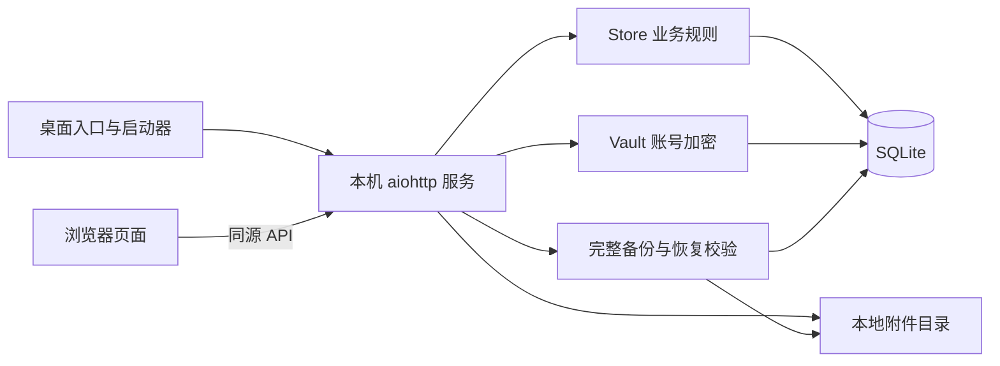

# 模块设计说明

本文说明 v1.2.0 的实现与设计取舍，供后续开发和维护阅读。操作步骤见 [README](../README.md)，使用者提出的修改及背景见 [需求与版本演进](EVOLUTION.md)。

## 1. 先确定业务边界

这个项目首先解决一台电脑上的量产记录问题：钱花到哪里、每套配件在哪里、每辆车用了哪块板、发到哪家店、现场资料放在哪里。界面尽量少填字段，同时保留实物追溯和账号保护。

| 原则 | 设计结果 |
| --- | --- |
| 钱和实物分别记录 | 入库不生成收支，收支不改变库存 |
| 实物追溯到每一套 | PCBA、结构件按编号保存，数量从记录统计 |
| 领用和装车可不同步 | 有“已领用待装车”中间状态 |
| 不重复扣减 | 配件出库扣可用量；整车出货只更新去向 |
| 历史必须能解释当前状态 | 库存流水、车辆历史、出货快照一起保存 |
| 现场资料形式不固定 | 账号使用自由文档，安装资料按项归档 |
| 用户填写的编码可以改变 | 关联使用内部稳定 ID，业务编码单独保存 |
| 单机先可用 | 本机服务、SQLite、文件附件，无云服务依赖 |

金额以整数分保存，日期按北京时间处理，界面展示人民币。“收支差额”只表达实际收入减实际支出，不做利润或应收应付推算。

## 2. 整体结构与代码职责

| 文件或目录 | 职责 | 不应承担的职责 |
| --- | --- | --- |
| `启动小车台账.cmd`、`launcher.py` | 定位项目、启动或复用服务、打开浏览器 | 修改业务记录 |
| `server.py` | HTTP、会话、来源校验、业务入口、附件、备份编排 | 仅凭前端清单认定库存有效 |
| `store.py` | 数据结构、库存与车辆规则、事务、流水、汇总 | 浏览器交互与文件预览 |
| `vault.py` | 数据密钥、密码封装、恢复密钥、账号加解密 | 自行发明加密算法 |
| `archive.py` | 一致快照、ZIP 清单、校验与安全解包 | 未校验即替换当前数据 |
| `static/app.js` | 页面、表单、扫码清单、附件与 PDF 预览 | 作为业务正确性的唯一保障 |
| `static/style.css`、`static/index.html` | 浅色桌面界面、布局与页面骨架 | 保存业务数据 |
| `static/vendor/pdfjs/` | 本地 PDF 渲染和所需资源 | 依赖外部 CDN |
| `tests/` | 使用独立数据验证关键规则 | 读取或修改正式台账 |

没有前端打包流程，减少本地安装步骤。启动器使用相对自身文件的位置定位数据，不依赖开发者机器的固定盘符。

## 3. 总览与查询

总览由数据库当前状态汇总收入、支出、可用配件、待装车和车辆状态。作废收支退出汇总；库存按配件状态统计，不维护另一份手工数量。

前端通过 `/api/state` 获取当前台账快照，统一刷新列表和详情。账号正文不会随全局快照返回。第一版采用适合本地小规模台账的全量状态与前端筛选；数据规模明显增大时再引入分页、服务端查询和增量刷新。

浅色界面使用左侧导航、右侧表格与详情，优先呈现编号、扫码入口和查询。抽屉详情支持点击左侧遮罩关闭；关闭判断排除弹窗和浮层交互，避免在预览或表单操作时误关。

## 4. 收支账本

### 只保留经常填写的信息

当前新增表单只有方向、分类、金额、日期、备注和附件。方向决定分类选项，前后端都验证分类。收入为“甲方回款”；支出为“PCBA采购、结构件采购、研发耗材、吃饭、差旅、出货耗材”。收入红色、支出淡绿色，是使用者明确指定的识别习惯。

往来方、关联门店、采购批次和用途事由从当前录入界面移除。需要补充的背景都写在备注里，降低日常记账负担。

### 现金流与库存分开

`ledger.save` 记录实际收付，不从入库数量或批次金额推导现金流。当前 `batch.create` 不生成支出。这样可以表达先到货后付款，也避免同一笔钱因入库与付款重复记账。

金额是正整数分，方向独立保存；浮点金额不进入业务层。作废使用标记和原因，保留原记录。普通编辑可以更新资料，但本版本不是逐字段财务审计系统。

### 兼容第一版数据

数据库仍保留旧的往来方、用途、关联字段，以及批次供应商和成本列；删界面字段不等于删除历史数据。新收支的旧字段留空，编辑旧收支时保留它们。旧分类在原方向和原分类未改变时允许继续保存。

旧用途与备注合并供界面查看；备注已编辑的标记防止用户清空备注后，旧用途又被自动带回。新入库的供应商为空、成本为零，不接受旧接口夹带的非零付款参数。

## 5. 入库与逐套库存

### 编号就是实物索引

`components` 每行代表一套实物，保存类型、编号、入库批次、当前状态、当前门店和修订号。`UNIQUE(kind, serial)` 在数据库层保证同一类型内编号唯一。编号是文本，保留前导零和大小写，不强加统一格式。

结构件编号就是车架号。PCBA 和结构件既有独立出库，也有独立入库入口，减少反复选择类型造成的误操作。`batches` 继续记录一次入库的分组，但当前产品不再承担采购成本、供应商或付款管理。

### 状态与允许的动作

| 内部状态 | 用户含义 | 典型来源 |
| --- | --- | --- |
| `available` | 在库可用 | 入库、明确退库 |
| `claimed` | 已领用待装车 | 装车领用出库 |
| `installed` | 已安装 | 装车、新板换入 |
| `spare` | 指定门店备件 | 备件出库、旧板留店 |
| `repair` | 待返修 | 标记返修、换板后的旧板去向 |
| `scrapped` | 已报废 | 报废操作、换板后的旧板去向 |

不是任意状态都能互相切换。每个动作检查当前状态、绑定关系和门店归属，成功后写入 `movements`。已安装配件不能脱离车辆关系直接退库或报废。

### 扫码只选中，确认才出库

扫码枪按键盘输入处理，回车加入清单；手输、搜索和批量输入共用业务验证。前端先排除重复项，提交后后端再检查每一项是否仍在库。整批操作要么成功，要么回滚，不产生半批出库。

## 6. 车辆档案与关系历史

车辆以车架号为业务身份，以稳定 ID 为内部关联。当前配对存于 `vehicles`，配对及去向变更追加到 `history`，配件状态变更追加到 `movements`。当前状态方便查询，历史解释它如何形成。

### 装车

仓库场景要求两种配件都已领用；门店场景要求两种配件都属于同一门店的备件。装车后配件为 `installed`，仓库车辆为 `ready`，门店装车车辆归该店并为 `shipped`。

一块 PCBA 同时只能在一辆有效车辆上，业务检查和数据库部分唯一索引共同约束。未配对完整的记录不能整车出货。没有换车架流程，避免第一版引入车辆身份迁移的额外复杂度。

### 换板

换板必须明确新板、日期、原因和旧板去向。仓库车辆使用 `claimed` 新板；门店车辆使用该门店的 `spare` 新板。旧板按选择进入待返修、退库、留店备件或报废，不能默认自动退库。

旧号、新号、位置及原因保留在历史中。同一门店备件换入车辆时只是 `spare → installed`，不会再次减少仓库可用量。

### 更正

撤销装车只允许未出货且没有后续变更的装车记录，配件回到已领用状态。业务历史不靠删除原行来“恢复”。发生后续操作时，应使用换板、转店或配件处理等业务动作。

## 7. 出货与转店

`shipments` 记录一笔出货，`shipment_items` 记录逐项清单及前后快照，可一次处理多台车。整车出货只更新车辆和已安装配件的位置，不重复扣除已领用配件。门店备件出库则从仓库可用状态转为指定门店备件。

车辆转店保留原门店和目标门店，配件随车辆移动；备件调拨单独记录。历史出货快照保存当时的 PCBA 号，后来的换板不会改写原始发货清单。

撤销时比对车辆、车架、PCBA 或备件的修订状态与操作后的快照，只有没有后续变化时才逆转。原单据标记撤销，追加更正记录，避免撤销旧单把新业务覆盖。

## 8. 门店、编码与账号备忘

### 门店身份与外部编码分离

门店有稳定内部 ID；车辆、出货和附件引用这个 ID。可填写编码单独保存在 `settings` 的 `store.code:<门店 ID>`，当前不改变数据库结构版本。编码可空，非空时精确区分大小写、全局唯一，去除首尾空白后保留前导零，最多 120 字符。

修改门店名称或外部编码不重建门店，不迁移车辆关系。此前 `STORE 01` 一类按列表顺序显示的文字不能承担对接标识；自填编码为将来对接外部平台预留业务字段，当前没有实现联网同步。

联系人、电话、地址和普通备注继续结构化保存。用户确认自由文档只替换账号备忘，不能把整个门店资料改成一个大文本框。

### 一店一份加密自由文档

账号备忘使用专用接口 `/api/stores/{store_id}/document`，内部复用 `credentials` 加密存储，以 `store-document:<门店 ID>` 为保留标识，正文负载为 `{"text": "..."}`。

文档最多 40000 字符，保留自由换行和空白。该上限兼顾中文和 JSON 转义后的加密负载限制；不是简单按英文字符体积估算。保存接口使用基于数据密钥的 HMAC 指纹做幂等匹配，避免在请求记录里存明文正文或普通可猜测内容指纹。

只有明确打开文档才读取正文，全局状态不返回正文或账号密文。专用接口检查门店所有权，旧账号接口禁止操作保留标识，防止通过普通账号接口绕过文档归属检查。

首次打开尚未建立的文档时，可将旧结构化账号解密整理成文本供编辑，但不自动保存或删除旧记录。已保存的空白文档也是有效结果，不会再次回退导入旧账号。

编辑后关闭、导航或刷新有未保存提示；保存期间输入区只读，避免请求提交后继续输入造成误判。锁定或失效时强制清除敏感界面，不能将敏感草稿写入 localStorage 作为自动恢复。

## 9. 附件与预览

附件归属于账目、入库批次、门店、车辆或出货，数据库保存所有者、资料项、原文件名、类型和大小，磁盘使用随机存储名，避免把用户文件名当作路径。

### 写入与替换顺序

单文件最多 50 MiB。文件先完整写入临时位置并落盘，验证所有者后在数据库事务里更新引用；成功后清理被替换的旧文件。门店同一资料项替换失败时旧引用仍有效。

普通附件通过独立资料项可保留多份；安装资料同一项覆盖当前版本。原文件名和文件大小相同，不足以认定是同一文件。上传重试使用请求标识与内容指纹，既防重复提交，也不误删不同内容。

账目保存与附件上传是分步操作。前端记住已持久化账目 ID，附件失败重试时只补传附件，不新建另一笔账目。

### 悬停直接查看

收支主列表“附件 N 份”根据所有者类型与 ID 找到严格归属的附件，鼠标停留即加载浮层，多文件切换、PDF 翻页在浮层内完成。详情附件列表和待上传列表也共用预览能力。

图片与 PDF 类型根据文件头识别，其他内容强制下载；不能因扩展名伪装成图片而执行 HTML。PDF.js 在本地 canvas 渲染，解决部分浏览器内嵌 PDF 空白的问题。

浮层使用浏览器顶层显示能力避免被弹窗盖住。关闭、滚动、切换台账或锁定时取消加载，销毁 PDF 渲染任务并释放对象 URL，避免显示错附件或继续保留敏感预览。

## 10. 事务、并发与幂等

所有库存、装车、换板和出货动作通过 `Store.action`，使用线程锁与 SQLite `BEGIN IMMEDIATE`。读取当前状态、校验、更新、追加历史和记录请求结果在同一个数据库事务内完成。

前端按钮禁用只改善交互，数据库约束和事务负责正确性。不同窗口即便使用不同请求 ID，也必须重新验证配件状态；不能靠“界面上看起来还在库”作为依据。

`requests` 保存请求 ID、规范化操作负载的指纹和结果。同 ID 同负载重试返回原结果；同 ID 换负载会拒绝。新业务使用新 ID。门店编码的重复检查也在写事务中，防止两个连接同时分配相同编码。

## 11. 账号保护与本机访问

`vault.py` 使用 cryptography 的 AES-GCM 和 Scrypt，不自行实现密码算法。随机数据密钥用于加密账号；密码与独立恢复密钥分别派生封装密钥，解锁同一个数据密钥。当前 Scrypt 参数为 `n=131072, r=8, p=1`，每份封装有独立随机材料。

加密将记录上下文作为附加认证数据，校验失败不能当作正常内容。修改密码只重新封装数据密钥，不重加密所有账号；恢复密码同时生成新恢复密钥。旧备份保留旧封装，不能被当前改密自动更新。

服务只监听回环地址，检查 Host、Origin 和跨站来源；写请求验证 CSRF 令牌，会话 Cookie 为 HttpOnly、SameSite=Strict。业务、附件、备份和账号接口均验证当前台账解锁状态。演示使用独立数据与演示密钥，不提供正式账号保护承诺。

解锁的数据密钥在进程会话内存中保存，服务端在约 30 分钟没有受保护 API 活动后失效，前端也有空闲锁定。两者计时来源不同：持续打字但不发请求仍可能导致服务端超时，应提醒及时保存；本版本没有后台续期草稿机制。

保护范围是门店账号正文和旧版账号内容。门店名称、编码、联系方式、普通备注、财务记录、附件及 ZIP 容器本身不加密。本机解锁和字段加密不替代操作系统账户、磁盘保护或整包加密。

## 12. 完整备份与恢复

备份使用 SQLite 一致快照，打包数据库引用的有效附件，并记录格式、台账类型、结构版本、文件大小与 SHA-256 清单。导出不包含明文密码或恢复密钥，但包含可用密码或恢复密钥解开的数据密钥封装。

恢复先在隔离目录检查 ZIP 路径、重复条目、体积限制、清单、文件哈希、数据库结构、完整性和外键，再用备份密码或恢复密钥验证每条加密账号。正式与演示备份不可混用。

通过全部验证后才在服务互斥区切换数据目录；切换或重新打开失败时回滚原目录。正式台账恢复后撤销旧会话并要求重新解锁。保留一个内部恢复前快照用于回滚，但它不是安装资料版本浏览功能，也不代替用户主动备份。

当前限制：ZIP 物理体积及解压总量各 2 GiB、数据库 256 MiB、单附件 50 MiB、清单 16 MiB、最多 25000 条目。哈希用于检测完整性，不是备份来源的数字签名。

## 13. 数据关系与接口索引

| 表 | 关键职责与关系 |
| --- | --- |
| `settings` | 密钥封装、门店编码及兼容标记 |
| `stores` | 门店基础信息，被车辆、出货和账号引用 |
| `batches` → `components` | 一次入库与逐套配件 |
| `vehicles` | 一个车架及当前 PCBA、状态和门店 |
| `movements`、`history` | 配件流水、车辆关系历史 |
| `shipments` → `shipment_items` | 出货或转店单据、逐项前后快照 |
| `ledger` | 实际收支及作废状态 |
| `attachments` | 文件所有者和磁盘引用 |
| `credentials` | 门店账号密文及自由文档密文 |
| `requests` | 幂等请求结果 |

| 接口族 | 用途 |
| --- | --- |
| `GET /health` | 启动器确认本程序是否已运行，不返回业务数据 |
| `/api/session`、`/api/auth/{operation}` | 会话、设置密码、解锁、锁定、改密与恢复 |
| `GET /api/state`、`POST /api/action` | 当前状态与受控业务操作 |
| `/api/stores/{store_id}/document` | 显式读取、保存账号自由文档 |
| `/api/credentials` 及其子路径 | 保留旧版结构化账号接口与兼容能力 |
| `/api/attachments` 及其子路径 | 上传、预览、下载、删除附件 |
| `/api/backup`、`/api/restore` | 导出完整备份、校验恢复 |
| `/api/shutdown` | 停止本机服务 |

这些是本机页面使用的内部 API，当前不作为对外平台的稳定集成合同。程序版本为 1.2.0，数据库与备份结构版本仍为 1，两者不是同一套版本号。

## 14. 验证与维护约束

| 测试文件 | 当前数量 | 关注点 |
| --- | --- | --- |
| `test_store.py` | 29 | 库存、配对、出货、更正、幂等、编码与旧数据兼容 |
| `test_http.py` | 11 | 来源校验、解锁、账号文档、附件权限与恢复入口 |
| `test_archive.py` | 10 | 文件完整性、路径、限额、数据库与加密内容校验 |
| `test_vault.py` | 3 | 密码、恢复密钥、加密认证 |

运行方法见 [README](../README.md)。交互还需检查主列表悬停、多附件、PDF 翻页、拖放、粘贴、扫码回车、抽屉关闭和未保存提示。53 项测试不等于所有浏览器及断电场景的完整证明。

后续修改应同时检查当前状态与历史是否一致、是否重复记账或扣库存、是否把普通字段误当加密字段。若需要改变使用者已确认的录入方式，先参考 [需求与版本演进](EVOLUTION.md)，不要仅根据旧数据库列名把已删字段重新暴露出来。
